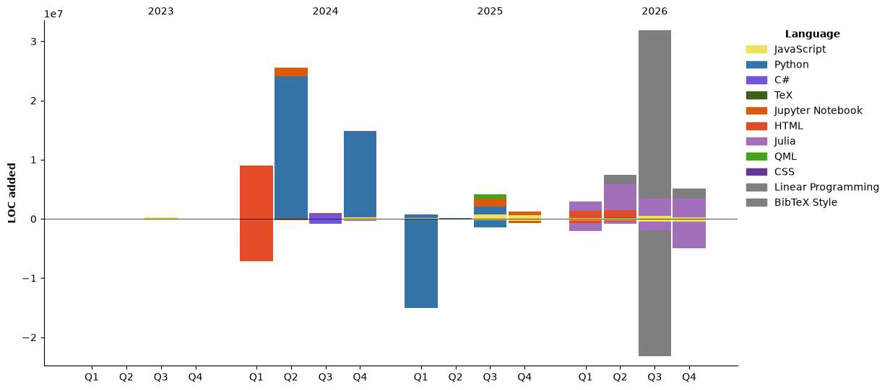

<div align="center">
  <a href="https://www.linkedin.com/in/brianna-laird/" target="_blank">
    
  </a>
  <a href="https://www.youtube.com/@Breezy-Codes/" target="_blank">
    
  </a>
  <a href="https://briannalaird.com/" target="_blank">
    
  </a>
  <a href="https://scholar.google.com/citations?user=exg3AzgAAAAJ&hl=en&oi=ao" target="_blank">
    
  </a>
</div>

## :sunglasses: About Me :sunglasses: 

- 👋 I’m Brianna, but you can call me Breezy.
- 🎓 Graduated with a Bachelor of Cyber Security (Honours) from Deakin University (WAM 96), receiving the Vice Chancellor's Prize, Coursework Research Award, Technical Leadership Award, and the David Stokes Award.
- 🎓 Pursuing a PhD in applied mathematics and communication engineering, focusing on disaster-resilient communication networks across both planning and operational phases.
- 🚒 Currently a PhD Intern with the Queensland Fire Department, working on optimising the type and location of aerial firefighting hubs.
- 🏆 Supported by an NHRA top-up scholarship, and recipient of the Deakin Scholarship for Excellence (Bachelors & Honours) and the Associate Dean Summer Research Scholarship (three times).
- 📖 Featured in the **Deakin Maths Yearbook** [2023](https://dro.deakin.edu.au/articles/book/Mathematics_Yearbook_2023/25824244/1) (Cryptography & Quantum Cryptography) and [2024](https://dro.deakin.edu.au/articles/book/Mathematics_Yearbook_2024/29670008/2) (Optimisation in Telecommunications). 
- 📄 Publications:  
  - [OFC 2025 - Optical x-haul for beyond 5G: cost-effective deployment strategies](https://opg.optica.org/abstract.cfm?uri=OFC-2025-M1I.3)
  - [JOCN - Cost-optimal network planning for converged optical X-haul in Beyond 5G networks](https://opg.optica.org/jocn/abstract.cfm?uri=jocn-17-11-E50)
  - [ACS 2026 - "You're not learning": A layered formative intervention to turn AI misuse into a learning opportunity](https://dl.acm.org/doi/pdf/10.1145/3786228.3786244)
  - [Computer Communications 2026 - Toward reconfigurable RAN in beyond 5G: A survey of architectural design, planning, and operation](https://doi.org/10.1016/j.comcom.2026.108655)
  - 2 papers under review
  - 3 papers currently in progress
---

## 🔬 Research Focus

- **Disaster-Resilient Communications:** Probabilistic modelling and GIS-driven frameworks to maintain emergency telecommunications reliability during natural hazards.
- **Telecommunication Network Planning:** Optimisation frameworks for efficient x-haul deployment in beyond 5G networks, addressing rural connectivity challenges.
- **Mathematics & Network Optimisation:** Applying advanced mathematical programming to reconfigurable RAN design and cost-effective deployment.
- **Graph Theory & Operations Research:** Using combinatorial optimisation and graph-based methods for scalable network planning.

---

## 🛠️ Current Projects

- **PhD Research & Software:**
  - [Emergency Facility Telecom GIS](https://github.com/breezy-codes/Emergency-Facility-Telecom-GIS) — A probabilistic GIS framework for emergency telecommunications resilience and infrastructure planning.
  - **Julia Packages *(In Development)*:** A network calculus library for deterministic performance bounds and a packet-level simulation package for evaluating network performance.
- **Honours Project:** MILP, heuristic models, and synthetic data generation for scalable O-RAN / x-haul planning, developed during my honours research.
  - [Network Optimisation Framework](https://github.com/breezy-codes/B5G-network-planning-algorithms) - [Network Dataset Generator](https://github.com/breezy-codes/B5G-network-dataset-generator)
- **Obsidian Repositories:** Tools and enhancements for the Obsidian knowledge ecosystem.  
  - [Obsidian CSS Snippets](https://github.com/breezy-codes/Obsidian-CSS-Snippets) - [Obsidian Completr](https://github.com/breezy-codes/obsidian-completr) - [Obsidian Callouts](https://github.com/breezy-codes/obsidian-Callouts) - [Bibtex to md generator](https://github.com/breezy-codes/obsidian-bibtex-2-md-generator)
- **Obsidian Knowledge Base & Guides:** A growing collection of structured notes, LaTeX resources, and tutorials.  
  - [Telecommunication Notes](https://github.com/breezy-codes/obsidian-telecommunication-definition-notes) - [Cheat Sheets](https://github.com/breezy-codes/Cheat-Sheets) - [Computer Networks Guide Book](https://comp-networks.breezy-codes.com)
- **Maths Repos:** Collections, experiments, and notes in optimisation, cryptography, graph theory, and applied mathematical modelling.  
  - [Greedy Algorithm](https://github.com/breezy-codes/Greedy-Algorithm) - [Bushfire Modelling Notes](https://github.com/breezy-codes/obsidian-bushfire-modelling-notes) - [Maths Definitions Notes](https://github.com/breezy-codes/obsidian-mathematics-definitions) - [The World of Cryptography](https://crypto.breezy-codes.com) - [Quantum Cryptography](https://quantum-crypto.breezy-codes.com)

---

## 🤝 Group Collaborative Projects

- **[Eclectic Sheep Society](https://github.com/breezy-codes/Eclectic-Sheep-Society):** Hackathon project visualising alcohol consumption statistics in Australia.
- **Capstone Projects:**
  - [SplashKit](https://github.com/splashkit): Added new functions to Splashkit library, developed tutorials, and led a capstone team.  
  - [Thoth Tech](https://github.com/thoth-tech): Extended company documentation and contributed to multiple projects.

---

<!--START_SECTION:waka-->


**🐱 My GitHub Data** 

> 📦 8.6 MB Used in GitHub's Storage 
 > 
> 🏆 2,984 Contributions in the Year 2026
 > 
> 💼 Opted to Hire
 > 
> 📜 38 Public Repositories 
 > 
> 🔑 56 Private Repositories 
 > 
**I'm an Early 🐤** 

```text
🌞 Morning                3176 commits        ██████████░░░░░░░░░░░░░░░   41.45 % 
🌆 Daytime                4148 commits        ██████████████░░░░░░░░░░░   54.13 % 
🌃 Evening                339 commits         █░░░░░░░░░░░░░░░░░░░░░░░░   04.42 % 
🌙 Night                  0 commits           ░░░░░░░░░░░░░░░░░░░░░░░░░   00.00 % 
```
📅 **I'm Most Productive on Monday** 

```text
Monday                   1186 commits        ████░░░░░░░░░░░░░░░░░░░░░   15.48 % 
Tuesday                  1107 commits        ████░░░░░░░░░░░░░░░░░░░░░   14.45 % 
Wednesday                1023 commits        ███░░░░░░░░░░░░░░░░░░░░░░   13.35 % 
Thursday                 1106 commits        ████░░░░░░░░░░░░░░░░░░░░░   14.43 % 
Friday                   1090 commits        ████░░░░░░░░░░░░░░░░░░░░░   14.22 % 
Saturday                 1037 commits        ███░░░░░░░░░░░░░░░░░░░░░░   13.53 % 
Sunday                   1114 commits        ████░░░░░░░░░░░░░░░░░░░░░   14.54 % 
```


📊 **This Week I Spent My Time On** 

```text
🕑︎ Time Zone: Australia/Sydney

💬 Programming Languages: 
Markdown                 45 hrs 44 mins      ████████████████████████░   97.24 % 
TeX                      38 mins             ░░░░░░░░░░░░░░░░░░░░░░░░░   01.37 % 
Text                     31 mins             ░░░░░░░░░░░░░░░░░░░░░░░░░   01.10 % 
Julia                    4 mins              ░░░░░░░░░░░░░░░░░░░░░░░░░   00.15 % 
Python                   3 mins              ░░░░░░░░░░░░░░░░░░░░░░░░░   00.11 % 

🔥 Editors: 
Obsidian                 45 hrs 44 mins      ████████████████████████░   97.24 % 
VS Code                  1 hr 17 mins        █░░░░░░░░░░░░░░░░░░░░░░░░   02.76 % 

💻 Operating System: 
Linux                    47 hrs 2 mins       █████████████████████████   100.00 % 
```

🤖 **AI Coding This Week** 

```text
No AI Coding Activity Tracked This Week
```

**I Mostly Code in TeX** 

```text
TeX                      17 repos            ██████░░░░░░░░░░░░░░░░░░░   22.37 % 
Python                   13 repos            ████░░░░░░░░░░░░░░░░░░░░░   17.11 % 
Julia                    8 repos             ███░░░░░░░░░░░░░░░░░░░░░░   10.53 % 
Linear Programming       5 repos             ██░░░░░░░░░░░░░░░░░░░░░░░   06.58 % 
BibTeX Style             2 repos             █░░░░░░░░░░░░░░░░░░░░░░░░   02.63 % 
```


**Timeline**




 Last Updated on 19/11/2026 01:51:44 UTC
<!--END_SECTION:waka-->


## 📊 GitHub Stats

<div align="center">
    
</div>

<div align="center">
    
    
</div>

---

<div align="center">
  <h3>Languages</h3>
  
</div>

<div align="center">
  <h3>Tools</h3>
  
</div>
